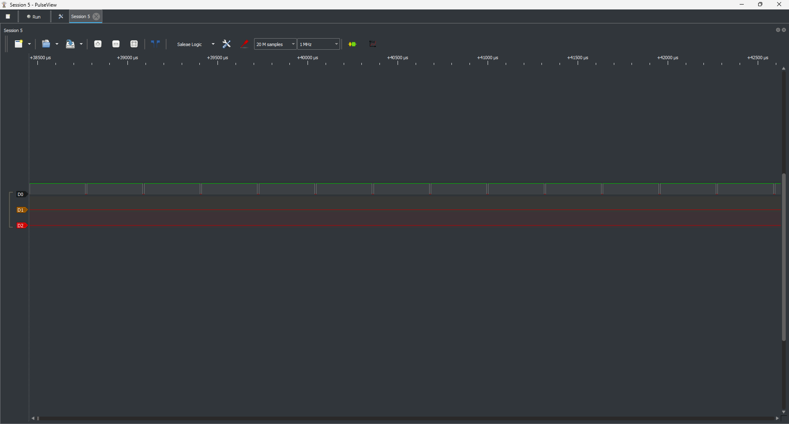
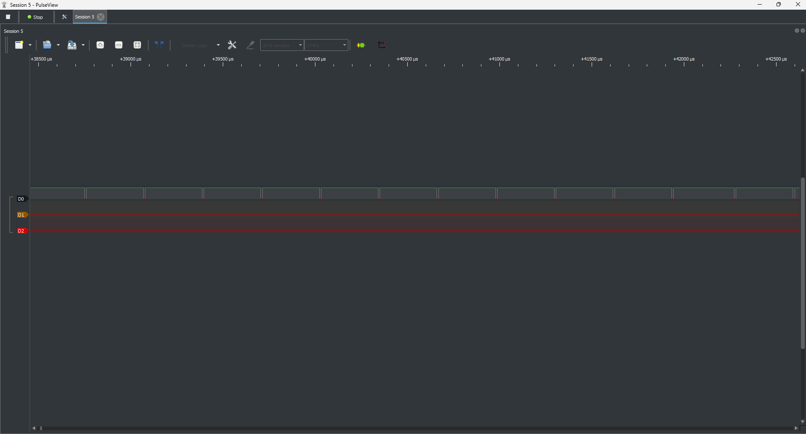
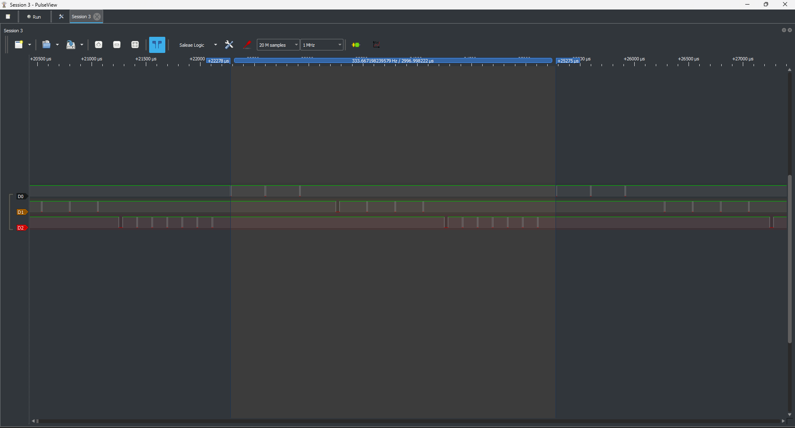

# Report — Week 1 / Ex2

`student_id`: 2412108    Commit của PREDICTION.md: 835f4d6

## 1. CPU share đo được
| Cấu hình | A (%) | B (%) | C (%) | Time slice đo được | Ảnh |
|---|---|---|---|---|---|
| B2: preempt=1, ưu tiên khác nhau | 100  | 0  | 0  | — | [PulseView B2](measurements/B2/Screenshot1.png) |
| B3: preempt=0, ưu tiên khác nhau | 100  | 0 | 0  | — | [PulseView B3](measurements/B3/Screenshot2.png) |
| B4: preempt=1, cùng ưu tiên | 33.317 | 33.317 | 33.328 | ≈ 0.999 ms | [PulseView B4](measurements/B4/Screenshot3.png), [runtime B4](measurements/B4/Screenshot%202026-10-19%20165315.png) |
| B5: sau khi sửa starvation | 41.221 | 20.476 | 25.908 | — (các task chủ động block) | [PulseView B5](measurements/B5/Screenshot%202026-10-19%20142547.png), [runtime A/B/C](measurements/B5/Screenshot%202026-10-19%20170631.png), [runtime Idle và tổng](measurements/B5/Screenshot%202026-10-19%20170700.png) |

Cách xác định CPU share:

- B2/B3: A luôn Ready và có ưu tiên cao nhất; ảnh PulseView cho thấy chỉ A có hoạt động GPIO. Tỷ lệ 100/0/0 được suy ra khi xét thời gian chạy giữa ba task A/B/C, chưa tách thời gian ngắt; đây không phải số runtime đo trực tiếp.
- B4/B5: dùng FreeRTOS runtime stats với bộ đếm DWT, chụp sau khoảng 10 giây. CPU share = `ulRunTimeCounter / runtimeTotal × 100%`. Không lấy duty cycle GPIO làm CPU share vì chân có thể giữ HIGH khi task bị preempt. Thời gian ISR được tính chung vào task đang được scheduler chọn.
- B4: `runtimeTotal = 80030713`; A = `26664000`, B = `26664000`, C = `26672432`, Idle = `0`. Time slice được ước lượng từ khoảng cách đầu hai cụm hoạt động A liên tiếp: `2997 µs / 3 ≈ 999 µs`.
- B5: `runtimeTotal = 80032937`; A = `32990308`, B = `16387716`, C = `20734791`, Idle = `9888019` (12.355%). Tải A/B/C = 300/240/120 µs, ưu tiên 4/2/3, mỗi task gọi `vTaskDelay(1)` sau công việc.
- Tổng phần trăm có thể nhỏ hơn 100% vì lượt chạy hiện tại chưa được cộng đầy đủ tại thời điểm chụp thống kê. Phần thiếu không được tự quy thành thời gian Idle.

Ảnh PulseView B2 — ưu tiên khác nhau, bật preemption:

Ảnh PulseView B3 — ưu tiên khác nhau, tắt preemption:

Thống kê runtime B4:

Thống kê runtime B5:

## 2. Preemption nhìn thấy ở đâu
Trên ảnh **bước 4** (cùng ưu tiên, round-robin), chỉ ra ít nhất **2 thời điểm**
preemption xảy ra. Với mỗi thời điểm: dấu thời gian, task bị cắt, task chiếm CPU,
và vì sao (hết time slice, không phải block).

| t (us) | Task bị preempt | Task chiếm CPU | Lý do |
|---|---|---|---|
|21,062–21,251 µs |B |C |nhảy Tick |
|22,117–22,278 µs |C |A |nhảy Tick |

- Trong lần lấy mẫu đã chọn không có task nào bị Preempt trong lúc kéo GPIO xuống LOW (xung LOW kéo dài qua các Task khác) nên bảng trên chỉ có thể xác định được khoảng mà Preemption xảy ra chứ không thể xác định chính xác thời điểm xảy ra.

Ở **bước 2** (ưu tiên khác nhau, đều busy-loop không block): giải thích vì sao ảnh
của bạn cho thấy **0 thời điểm preemption**, dù chạy bao lâu đi nữa — dựa vào điều
kiện preemption của FreeRTOS, không phải "vì ảnh chụp chưa đủ dài".  
- Vì Task A có thứ tự ưu tiên cao nhất nhưng không bao giờ block/yield nên dù có chạy bao lâu đi nữa thì cũng không bị preempt bởi các Task khác.

## 3. Time slice
Time slice đo được ở bước 4: ≈ 0.999 ms. `configTICK_RATE_HZ` = 1000Hz.
Sai số: -0.1 %. Giải thích sai số: Time slice được ước lượng từ khoảng cách hai cụm GPIO, không đo trực tiếp context switch nên độ lệch có thể gồm vị trí cạnh GPIO so với lúc chuyển task. Ngoài ra cũng có thể là do sự chênh lệch clock giữa MCU với logic analyzer.

Ảnh B4 — khoảng cách giữa đầu hai cụm A liên tiếp khoảng 2997 µs:

## 4. DWT wrap-around
Tại sao so sánh `DWT->CYCCNT > target` bị sai sau ~59 giây, và cách viết đúng:  
- Trả lời: vì DWT->CYCCNT có thể bị wrap-around về lại 0 nên phép so sánh không còn đúng nữa.
- Cách viết đúng là (uint32_t)(DWT->CYCCNT - start) > target.

## 5. Sửa starvation
Cách tôi chọn: Thêm vTaskDelay(1), mỗi Task sau khi clear GPIO xuống 0 thì bị Block cho đến Tick kế tiếp.
Vì sao nó hoạt động (dựa vào trạng thái task trong scheduler): Sau khi Task A hoàn thành thì nó bị block cho đến Tick kế tiếp, Task C có thể chạy, sau khi C chạy xong thì cũng bị block đến Tick kế tiếp và lúc này nếu A vẫn còn bị block thì B được chạy => Hạn chế được Starvation khác nhiều.
Đánh đổi: các task không được xử lý một cách liên tục, có một khoảng CPU idle không làm gì.

Ảnh B5 — cả ba task đều được chạy sau khi thêm block:

## 6. Lệch so với dự đoán
Mỗi mục lệch + nguyên nhân vật lý.  

Ngoài việc lệch giá trị time slice đã giải thích ở mục 3. thì còn một phần nữa là %CPU ở trong Idle Task thu được ở B5 chỉ là khoảng 12% thay vì 34% như trong predict. Nguyên nhân là do Predict đã bỏ qua các tác vụ khác mà CPU phải thực hiện bên cạnh Idle Task khi cả 3 Task A, B, C đều bị block.

## 7. Câu hỏi đánh đổi
Với **bộ ưu tiên của bạn**, nếu `TASK_C_WORK_US` tăng gấp 3 lần thì bảng CPU share ở
bước 2 thay đổi thế nào? Trả lời bằng số suy ra từ dữ liệu của bạn, rồi **đo lại để
kiểm chứng**. Nếu lệch, giải thích.  
Trả lời: Đối với B2 và B3, việc tăng tải của Task C không làm thay đổi CPU share vì Task A vẫn có Prio cao nhất.

Ảnh kiểm chứng B2 khi tăng tải C từ 120 lên 360 µs:

