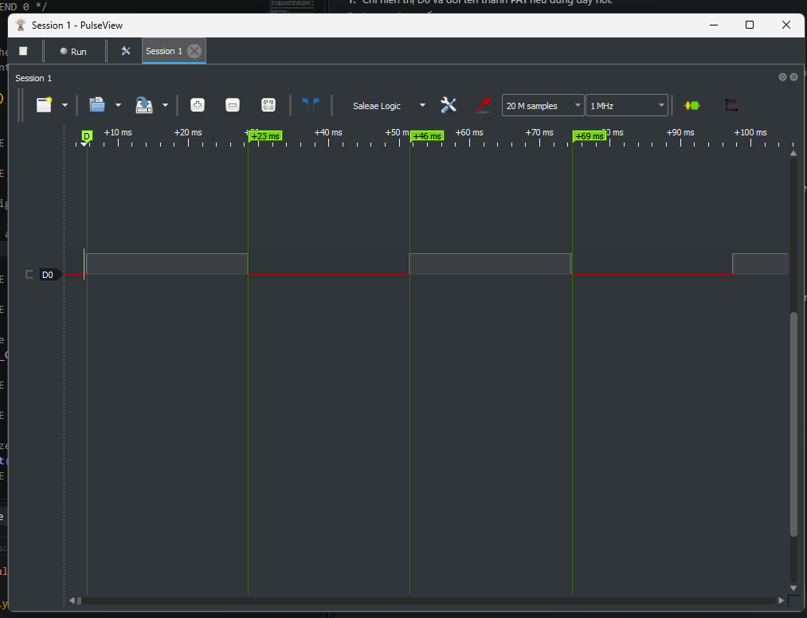
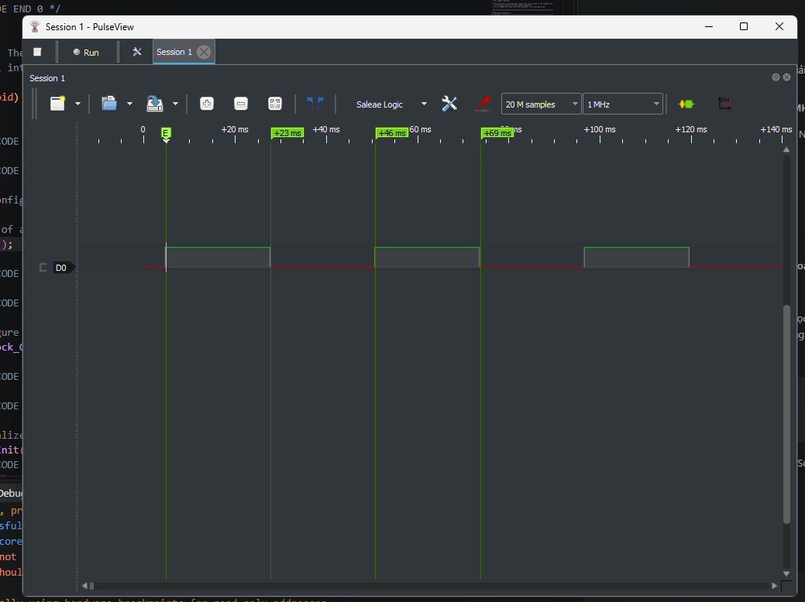
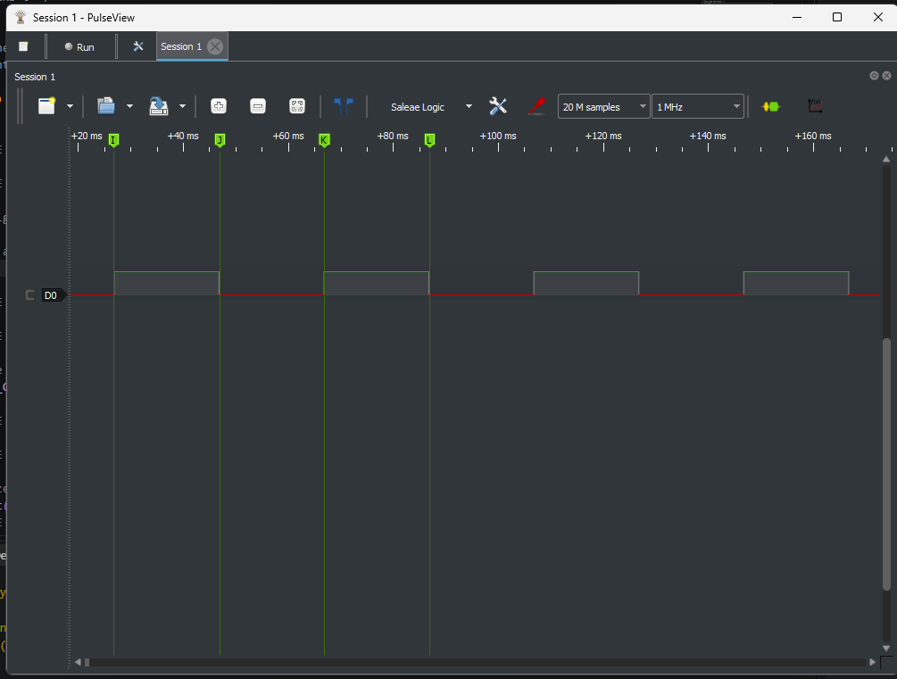
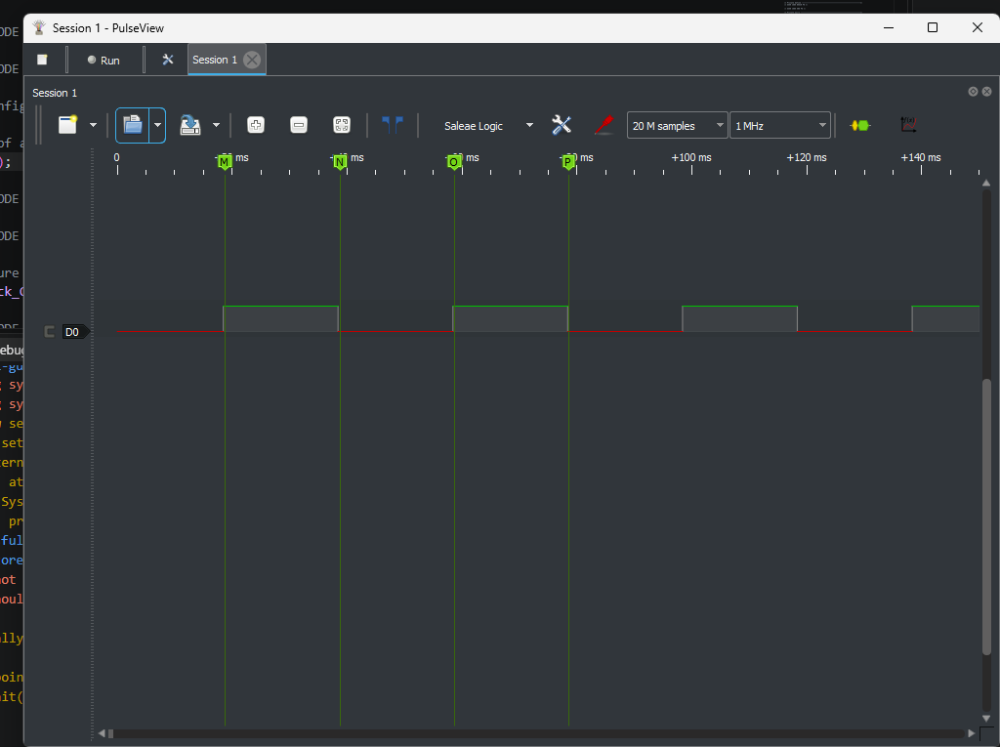

# Report — Week 1 / Ex3

`student_id`: 2412108    Commit của PREDICTION.md: 51de1d2

## 1. Bảng thống kê (tính từ CSV, không đọc tay)
| # | Delay | Tick | min (ms) | max (ms) | tb (ms) | jitter = max−min (us) | drift tổng (ms) |
|---|---|---|---|---|---|---|---|
| 1 | `vTaskDelay` | 1000 |22.98 |22.981 |22.981 |1 |-9.693 |
| 2 | `xTaskDelayUntil` | 1000 |22.98 |22.981 |22.981 |1 |-9.684 |
| 3 | `vTaskDelay` | 100 |19.983 |19.984 |19.983 |1 |-1508.426 |
| 4 | `xTaskDelayUntil` | 100 |19.983 |19.984 |19.983 |1 |-1508.426 |

- Script dùng để tính: [analyze_timing.py](tools/analyze_timing.py)
- CSV gốc (commit kèm): [cfg1](measurements/cfg1/data.csv), [cfg2](measurements/cfg2/data.csv), [cfg3](measurements/cfg3/data.csv), [cfg4](measurements/cfg4/data.csv)
- Ảnh:
- Cấu hình 1: 
- Cấu hình 2: 
- Cấu hình 3: 
- Cấu hình 4: 

## 2. Tại sao `vTaskDelay` bị drift
Công thức drift theo `PERIOD_MS` và `WORK_JITTER_US` của **bạn**, rồi so với số đo:

| | Tính theo công thức | Đo được | Lệch |
|---|---|---|---|
| Drift tổng (ms) |0 |−9,693 |−9,693 |

## 3. Tại sao tick 100 Hz sai nhiều hơn
`PERIOD_MS` = 23 ; một tick = 10 ms. Chứng minh bằng số đo, không bằng lý thuyết: Theo số đo ở trên thì với 1000Hz, khoảng toggle trung bình là 22.981ms, sai lệch với mong muốn 23ms là -0.019ms. Còn với 100Hz, toggle trung bình là 19.983, tức sai lệch hẳn -3,017ms

## 4. `xTaskDelayUntil` trả về gì
Giá trị trả về nghĩa là gì, và trong 4 lần chạy của bạn nó có bao giờ báo
"đã trễ deadline" không? Bao nhiêu lần / `SAMPLE_COUNT`?  
Trả lời: xTaskDelayUntil trả về pdTRUE nếu Task thật sự bị block, trả về pdFALSE nếu mốc đã qua và không block Task. Trong 4 lần chạy hiện tại chưa thấy báo "trễ deadline", noBlockCount = 0.

## 5. Lệch so với dự đoán
Mỗi dòng lệch trong bảng → lệch bao nhiêu + nguyên nhân vật lý.  
Trả lời:  
| # | Delay | Predict(ms) | Đo được(ms) | Lệch() |
|---|---|---|---|---|
| 1 | `vTaskDelay` | 0 | -9.693 | -9.693 |
| 2 | `xTaskDelayUntil` | 0 | -9.684 | -9.684 |
| 3 | `vTaskDelay` | -1500 | -1508.426 | -8.426 |
| 4 | `xTaskDelayUntil` | -1500 | -1508.426 | -8.426 |

Nguyên nhân có thể là do thạch anh ngoài giao động nhanh hơn 8MHz một chút dẫn đến 1ms trôi qua chậm hơn 1 tick của kernel => Task hoàn thành nhanh hơn so với mốc dự đoán

## 6. Câu hỏi đánh đổi
Tick 1000 Hz cho độ chính xác tốt hơn nhưng **tốn** gì? Dựa vào dữ liệu của bạn:
đo CPU overhead của tick ISR ở 100 Hz và 1000 Hz (gợi ý: cho một task ưu tiên thấp
nhất đếm vòng lặp trong 1 giây, so sánh 2 cấu hình). Điền số:

| Tick rate | Số vòng lặp idle đếm được trong 1 s | Overhead suy ra (%) |
|---|---|---|
| 100 Hz |111134 | |
| 1000 Hz |109455 |1.51% |

Khi tăng tick rate từ 100 lên 1000 Hz, số vòng Idle thực hiện được giảm khoảng 1,51%.

Với ứng dụng `PERIOD_MS` = 23 của bạn, em chọn 1000Hz vì chênh lệch không nhiều nhưng với độ phân giải 1 tick cao hơn thì task được đảm bảo đúng giờ hơn.
