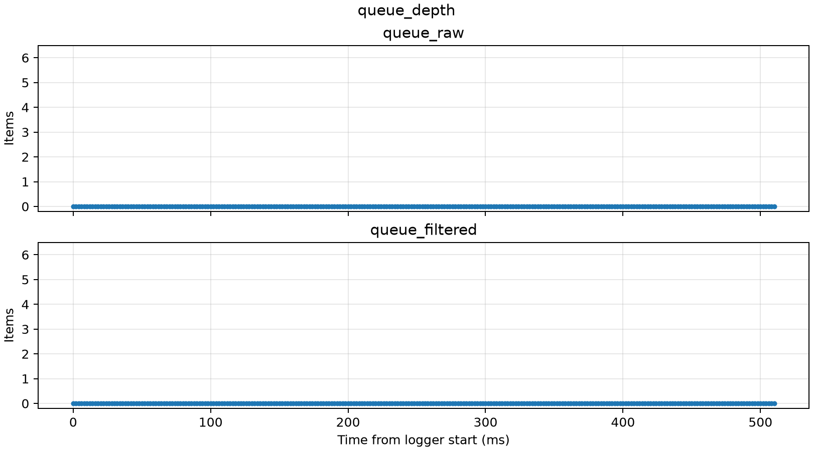
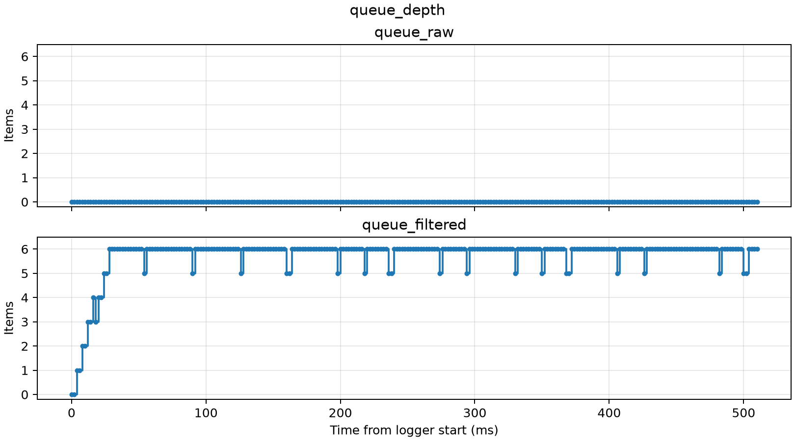

# Report — Week 2 / Ex1

`student_id`: 2412108    Commit của PREDICTION.md: c4dd892

Cấu hình: ADXL345, CPU 72 MHz, I2C 400 kHz, chu kỳ đọc 4 ms; priority sensor/filter/UART = 3/2/1. Các lượt chính dùng cửa sổ 16, mỗi queue dài 6. Logger ghi 256 mẫu mỗi 2 ms, từ 0–510 ms.

## 1. Kích thước queue tối thiểu

| | Dự đoán | Đo được | Khớp? |
|---|---|---|---|
| `queue_raw` | 1 | Đã thử dài 1, không drop | Có, trong lượt thử |
| `queue_filtered` | 1 | Đã thử dài 1, không drop | Có, trong lượt thử |

Nếu lệch: nguyên nhân (thời gian xử lý thực tế khác ước lượng, jitter I2C, ...).

**Trả lời:** Q1 dùng UART 115200, cả hai lần gửi timeout 0. Log có 2348 mẫu liên tục, seq 0–2347; các bộ đếm lỗi/drop đều 0.

Bằng chứng: [Watch Q1](measurements/Q1/watch_Q1.png), [log Q1](measurements/Q1/uart_log.log).

## 2. Đồ thị độ đầy queue theo thời gian

Cấu hình bình thường: ``



Cấu hình UART chậm (9600 baud): ``



Giải thích hình dạng đồ thị ở mỗi cấu hình.

**Trả lời**:

- N16: hai queue đều được quan sát ở mức 0 vì mẫu được nhận và xử lý nhanh.
- S0: UART không theo kịp đầu vào, filtered tăng đến 6 rồi chủ yếu dao động 5–6; raw vẫn được filter nhận kịp nên quan sát ở mức 0.

[Watch N16](measurements/N16/watch_N16.png), [log N16](measurements/N16/uart_log.log).

## 3. Khi nào queue đầy

Mô tả **chính xác** thời điểm `queue_filtered` bắt đầu đầy khi hạ baud, và số
mẫu bị mất/trễ (đếm bằng số thứ tự mẫu gắn trong payload).

**Trả lời:** S0 lần đầu quan sát filtered đầy ở **28 ms** tính từ lúc logger bắt đầu. Đây là mốc quan sát với chu kỳ logger 2 ms, không phải cạnh đầy chính xác.

Filter bỏ 94 mẫu trong cửa sổ đo 510 ms. Trên toàn log UART dài hơn, ghi nhận 1343 seq bị thiếu.

Bằng chứng: [Watch S0](measurements/S0/watch_S0.png), [log S0](measurements/S0/uart_log.log), [CSV độ đầy](measurements/S0/queue_depth_analysis/depth.csv).

## 4. Hành vi 3 kiểu timeout

| Timeout | Kết quả quan sát khi queue đầy |
|---|---|
| 0 | S0 (filter gửi không chờ): filter bỏ 94 mẫu, sensor drop 0, filtered đầy ở 28 ms |
| giá trị hữu hạn | SF (filter chờ tối đa 10 ms): filter bỏ 25 mẫu, raw bị dồn và sensor bỏ 62 mẫu. Filtered/raw lần đầu thấy đầy ở 28/76 ms. |
| `portMAX_DELAY` | FI (filter chờ đến khi gửi được): filter drop 0, raw đầy ở 64 ms, sensor vẫn gửi không chờ nên bỏ 87 mẫu. |

SI bổ sung (cả sensor/filter chờ vô hạn): không drop tại hai lệnh gửi queue, seq liên tục, hai queue vẫn đầy. Sensor vẫn có thể đọc trễ và bỏ qua dữ liệu nội bộ cảm biến.

Bằng chứng: [SF](measurements/SF/watch_SF.png), [FI](measurements/FI/watch_FI.png), [SI](measurements/SI/watch_SI.png). Các lỗi I2C, định dạng và truyền UART đều 0.

## 5. Lệch so với dự đoán

Mỗi mục lệch + nguyên nhân vật lý.

**Trả lời:**

- **Queue tối thiểu:** Dự đoán mỗi queue chỉ cần dài 1 khi UART 115200. Lượt Q1 không có drop và seq liên tục → khớp trong điều kiện thử.

- **Queue đầy trước:** Dự đoán filtered đầy trước khi hạ baud xuống 9600. S0 lần đầu quan sát filtered đầy ở 28 ms, raw chưa thấy đầy → khớp.

- **Gửi timeout 0:** Dự đoán mẫu mới bị bỏ khi queue đầy. S0 có filter drop = 94 tại cuối capture → khớp.

- **Gửi chờ vô hạn:** Dự đoán task bị block, có thể làm trễ nhịp đọc cảm biến. SI có drop = 0 nhưng hai queue đầy; backpressure có thể làm sensor đọc trễ.

- **Độ đầy raw bình thường:** Dự đoán gần 0, tăng lên 1 khi có mẫu. N16 quan sát toàn 0 vì logger lấy mỗi 2 ms có thể bỏ sót khoảng chứa mẫu ngắn; không mâu thuẫn với dự đoán.


## 6. Câu hỏi đánh đổi

Với `SAMPLE_PERIOD_MS` của **bạn**, nếu `FILTER_WINDOW` tăng gấp đôi thì độ trễ
từ cảm biến đến UART tăng thêm bao nhiêu ms? Trả lời bằng số từ dữ liệu của bạn,
rồi đo lại để kiểm chứng.

**Dự đoán:** Tách hai ý: thời gian qua pipeline gần như không đổi vì running sum chỉ cập nhật một mẫu mỗi lượt còn phản hồi bộ lọc chậm thêm khoảng 32 ms khi cửa sổ 16 → 32, chu kỳ 4 ms.

**Kết quả đo:**

| Đại lượng | Cửa sổ 16 | Cửa sổ 32 | Tăng thêm |
|---|---:|---:|---:|
| Pipeline, TB 200 mẫu cảm biến thật | 1,904737 ms | 1,912282 ms | **0,007545 ms** |
| Đáp ứng bước 50% đến truyền xong UART | 29,196361 ms | 61,192458 ms | **31,996097 ms** |

Pipeline: đo từ trước đọc I2C đến khi UART truyền xong, chỉ lấy mẫu khi cửa sổ đầy. Kết quả gần như không đổi. [L16](measurements/L16/watch_L16.png), [N32](measurements/N32/watch_N32.png).

Phản hồi: dùng dữ liệu thử 0 → 1000 tại seq 64, không phải chuyển động cảm biến thật. Đo từ trước gửi mẫu bước nhảy vào raw queue đến UART truyền xong bản tin đầu tiên có giá trị lọc ≥500. Cửa sổ 16 đạt ngưỡng ở seq 71, cửa sổ 32 ở seq 79:

```text
Đến mẫu đạt 50%: (8 − 1) × 4 = 28 ms; (16 − 1) × 4 = 60 ms
Chênh lệch dự đoán: 60 − 28 = 32 ms
Đo đến truyền xong UART: 61,192458 − 29,196361 = 31,996097 ms
```

Hai số tuyệt đối còn gồm truyền UART/xử lý. Đây là đáp ứng bước 50%, không gọi trực tiếp là group delay. Các lượt latency và STEP đều không lỗi/drop. [Watch STEP16](measurements/STEP16/watch_STEP16.png), [Watch STEP32](measurements/STEP32/watch_STEP32.png), [log STEP16](measurements/STEP16/uart_log.log), [log STEP32](measurements/STEP32/uart_log.log).
