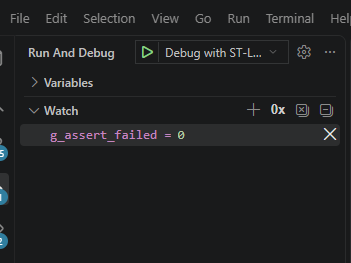
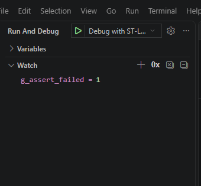
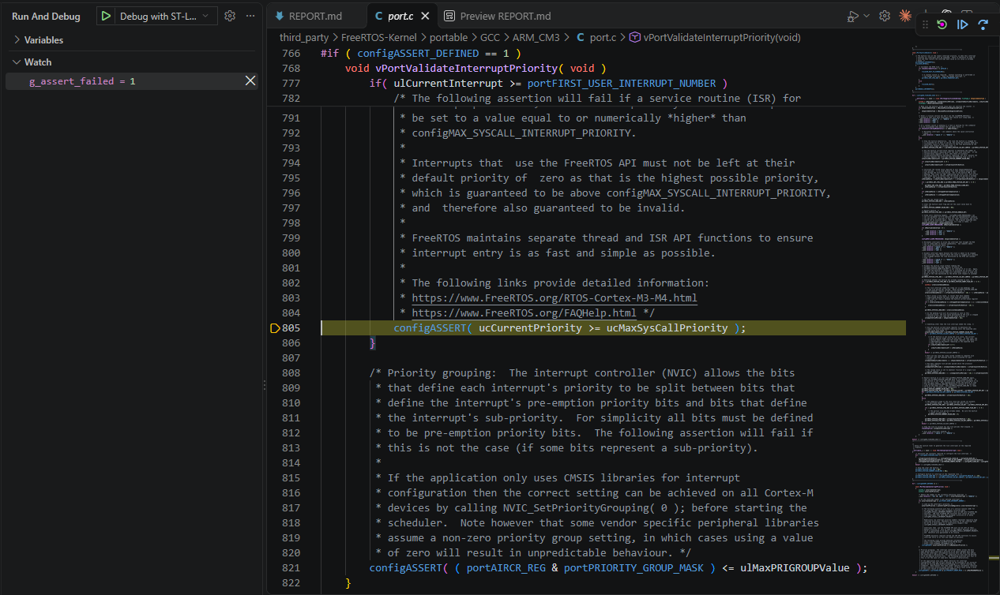
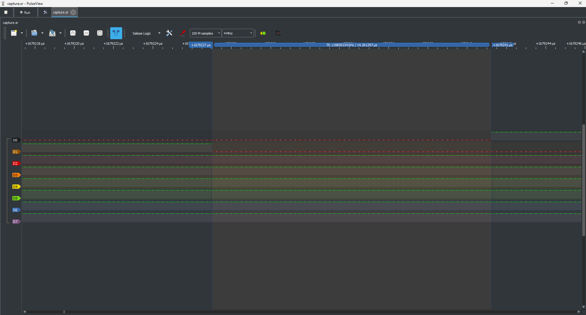
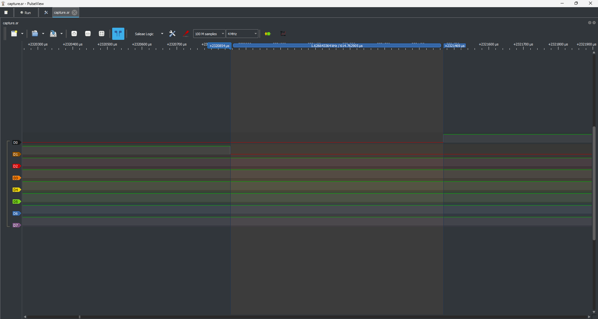
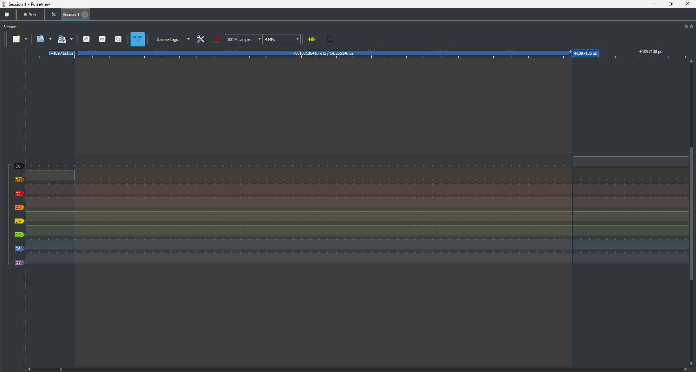

# Report — Week 3 / Ex1

`student_id`: 2412108    Commit của PREDICTION.md: `1509e03`


## 1. Bằng chứng configASSERT
Mô tả/log/ảnh lúc priority sai (bước 4 README) + giải thích chính xác **vì sao**
assert được kích hoạt (nêu đúng tên macro và điều kiện).

- Đặt EXTI1 priority **4**, trong khi
  `configLIBRARY_MAX_SYSCALL_INTERRUPT_PRIORITY = 5`. Khi nhấn PB1, ISR gọi
  `vTaskNotifyGiveFromISR()` và kernel kiểm tra trong
  `vPortValidateInterruptPriority()`:

  ```c
  configASSERT(ucCurrentPriority >= ucMaxSysCallPriority);
  ```

- Với 4 bit priority, giá trị mã hóa tương ứng là **0x40 < 0x50**, nên điều
  kiện sai. ISR priority 4 có ưu tiên phần cứng cao hơn ngưỡng cho phép gọi
  API FreeRTOS. Macro `configASSERT` tắt ngắt, đặt `g_assert_failed = 1`
  rồi lặp vô hạn; debugger xác nhận flag đổi **0 → 1** và dừng đúng assertion.







## 2. Latency ISR → task
| Cấu hình | Dự đoán (us) | Đo được (us) | Đạt `LATENCY_BUDGET_US`? |
|---|---|---|---|
| Có `portYIELD_FROM_ISR` | Khoảng 13,9 | TB 14,17; min–max 14,00–14,25 (13 mẫu) | Có, 13/13 mẫu dưới 80 µs |
| Không có `portYIELD_FROM_ISR` | Chờ tick kế tiếp, tăng khoảng 0–1000 | TB 460,40; min–max 42,50–1003,25 (26 mẫu) | Không, 24/26 mẫu vượt 80 µs |

Đo PB1 cạnh xuống → PA7 cạnh lên, EXTI priority 8, CPU 72 MHz, tick 1 kHz;
logic analyzer 4 MHz. Trung bình hai lượt chênh **446,23 µs**. Thống kê chỉ
chọn lần nhấn tách biệt khi PA7 LOW và task đã chờ, không tính cạnh nảy lúc
xung ACK trước còn bận.

`ack_task` có priority 3, cao hơn Idle (0), nên khi được đánh thức có thể
chạy ngay sau chuyển ngữ cảnh; không có task ứng dụng khác cạnh tranh CPU.

**Có yield:** [capture gốc](measurements/02_prio8_yield/capture.sr).



**Không yield:** [capture gốc](measurements/03_prio8_no_yield/capture.sr).



## 3. Giải thích quan hệ priority
Giải thích bằng lời của bạn: số NVIC priority nhỏ/lớn nghĩa là gì, vì sao
`configLIBRARY_MAX_SYSCALL_INTERRUPT_PRIORITY` tồn tại, điều gì xảy ra nếu một
ISR ưu tiên cao hơn ngưỡng này gọi API FreeRTOS.  
- Số NVIC priority càng nhỏ thì ưu tiên càng cao, ngược lại với task priority.
- `configLIBRARY_MAX_SYSCALL_INTERRUPT_PRIORITY` bởi vì kernel không muốn chặn hết tất cả các ngắt trong quá trình nó xử lý dữ liệu nội bộ, các ngắt quan trọng có số priority nhỏ (ưu tiên cao) có thể chen ngang được. Tuy nhiên nó không được gọi API RTOS vì có thể làm hỏng dữ liệu nội bộ của kernel và `configLIBRARY_MAX_SYSCALL_INTERRUPT_PRIORITY` là ngưỡng mà các ngắt có priority < `configLIBRARY_MAX_SYSCALL_INTERRUPT_PRIORITY` không được gọi API RTOS.
- Khi cố tình gọi API RTOS trong các ngắt có số priority nhỏ hơn ngưỡng này, kernel sẽ gọi configASSERT trong cấu hình kiểm tra của bài.

## 4. Lệch so với dự đoán

| Dự đoán | Kết quả đo và nhận xét |
|---|---|
| Priority 8 hợp lệ, priority 4 gây assert | Khớp: bản priority 8 phản hồi bình thường; priority 4 kích hoạt assert kiểm tra priority. |
| Có yield: khoảng 13,9 µs | Trung bình 14,17 µs, lệch khoảng 0,27 µs. Ước lượng số lệnh/cycles chỉ gần đúng nên kết quả này phù hợp. |
| Không yield: latency tăng khoảng 0–1 ms | Trung bình tăng 446,23 µs; max latency 1003,25 µs. Phù hợp việc chờ tick kế tiếp, cộng thêm thời gian xử lý ISR và chuyển ngữ cảnh. |

## 5. Câu hỏi đánh đổi
Nếu tăng `ISR_NVIC_PRIO` của bạn lên một bậc (ưu tiên thấp hơn) trong khi vẫn
hợp lệ, latency đo được thay đổi bao nhiêu? Trả lời bằng số đo thật, không
đoán.  
- Khi tăng `ISR_NVIC_PRIO` từ 8 lên 9, latency điển hình gần như không đổi ở tải hiện tại vì chưa có tình huống ngắt cạnh tranh làm sự khác biệt ưu tiên này thể hiện rõ.

Bằng chứng đo với cùng cấu hình có yield, chỉ đổi EXTI priority **8 → 9**:

| Priority EXTI | Số mẫu chọn | Min (µs) | Trung bình (µs) | Max (µs) |
|---|---:|---:|---:|---:|
| 8 | 13 | 14,00 | 14,17 | 14,25 |
| 9 | 30 | 14,00 | 14,38 | 18,00 |

Trung bình chênh khoảng **0,20 µs**, latency điển hình gần như không đổi
ở tải đã thử; cả hai đều dưới budget 80 µs. Bản priority 9 có hai mẫu cao
hơn là 16,25 và 18,00 µs, nên không coi mọi mẫu đều giống nhau.
Thống kê chọn lần nhấn tách biệt khi task đã chờ, loại cạnh nảy/ACK còn bận.

Capture gốc: [priority 8](measurements/02_prio8_yield/capture.sr),
[priority 9](measurements/04_prio9_yield/capture.sr).


