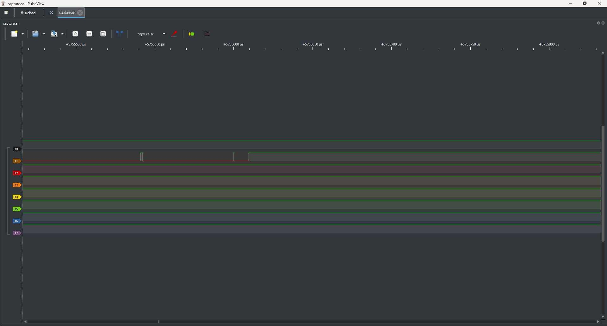
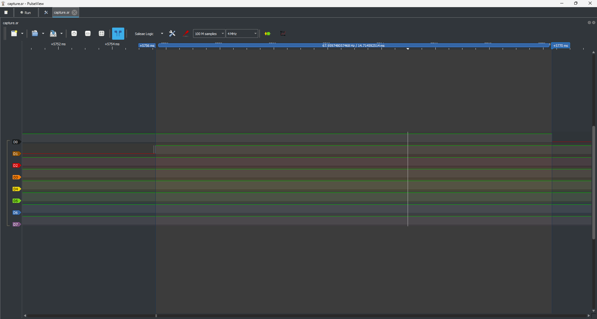
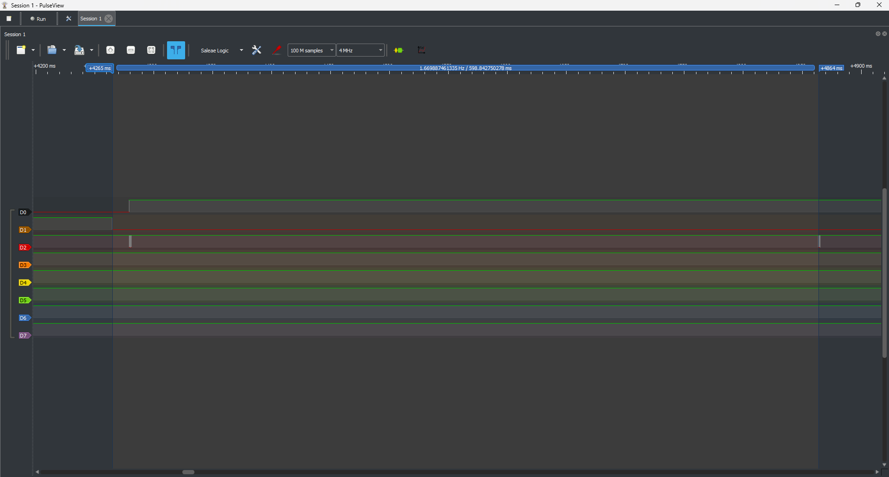

# Report — Week 3 / Ex2

`student_id`: 2412108    Commit của PREDICTION.md: `0f3e893`

## 1. Nảy phím trước/sau

Ảnh logic analyzer: tín hiệu thô (nhiều cạnh nảy) và tín hiệu sau debounce.

- Trong [capture 15 ms](measurements/01_debounce_15ms/capture.sr), PB1 có
  5 cạnh nảy khi nhả trong 68,5 µs, còn PA7 chỉ xuống LOW một lần.
- Cạnh PB1 cuối tại 5,7556095 s, PA7 tại 5,77032925 s: **14,71975 ms**.
  Trên 78 cạnh output, độ trễ quan sát **14,012–15,010 ms**.
- [Log UART](measurements/01_debounce_15ms/uart_log.log) ghi PRESS khi chuyển
  sang trạng thái nhấn ổn định; lúc nhả chỉ cập nhật output/trạng thái.

## 2. Callback bị block — thí nghiệm bước 4
| | Dự đoán | Đo được |
|---|---|---|
| Độ trễ `longpress_callback` khi `debounce_callback` block 50ms |Dự đoán không trễ |Khớp dự đoán: HELD đầu sau cạnh nhấn lần lượt 599,394 / 598,639 / 599,360 ms; các HELD liên tiếp cách 600 tick|

Bằng chứng: [log test block](measurements/03_callback_block_50ms/uart_log.log),
[capture đúng của test block](measurements/03_callback_block_50ms/capture_02.sr).

## 3. Giải thích daemon task
Giải thích **bằng cơ chế**, không chỉ hiện tượng: vì sao một callback block sẽ
ảnh hưởng timer khác, liên hệ đến timer command queue và việc có đúng MỘT
daemon task xử lý tất cả software timer.  
- Các software timer dùng chung daemon để chạy callback nên là khi một callback block daemon, và trong lúc block callback của timer khác đến hạn thì timer đó sẽ bị trễ. Các lệnh cũng gặp tình trạng tương tự, mặc dù được đưa vào queue nhưng daemon chưa thể xử lý ngay được vì đang block.

## 4. Long-press
Thời gian giữ thực tế đo được so với `LONGPRESS_MS`: khớp không?

- LONGPRESS_MS = 600 ms. Đo từ cạnh nhấn PB1 cuối tới đầu log HELD trên
  PA9 được **598,843 / 599,213 / 598,872 ms**, gần ngưỡng danh định.
  Các HELD tiếp theo cách nhau **600 tick**.

Bằng chứng: [log UART](measurements/02_hold_600ms/uart_log.log),
[capture có TX](measurements/02_hold_600ms/capture_02.sr).

## 5. Lệch so với dự đoán

| Dự đoán | Đối chiếu thực tế |
|---|---|
| Nảy thường khoảng 1–20 ms | Các cụm đã đo ngắn hơn: 68,5 µs, 206,5 µs và 802 µs; đây là kết quả các lần thử cụ thể, không đại diện mọi nút. |
| Debounce quá lớn có thể bỏ nhấn/nhả nhanh | Chưa đo riêng double-click với debounce lớn hơn nên chưa kết luận thực nghiệm. |
| Block 50 ms không làm HELD trễ nếu không chồng deadline | Phù hợp lượt đo: HELD đầu khoảng 598,639–599,394 ms. Chưa thử trường hợp deadline HELD nằm trong khoảng block. |
| HELD đầu khoảng 600 ms từ cạnh nhấn | Đo khoảng 598,843–599,213 ms tới đầu log HELD, phù hợp ngưỡng danh định, chưa tách riêng sai số clock và chi phí log. |

## 6. Câu hỏi đánh đổi
Với `DEBOUNCE_MS` của bạn, nếu giảm xuống còn một nửa thì tín hiệu sau debounce
còn sạch không? Đo lại trên board của bạn, không suy luận suông.  
- Theo dự đoán thì debounce_ms nhiều khả năng là không ảnh hưởng hiệu quả debounce vì ta luôn tính timer từ xung cuối cùng. Kết quả thực nghiệm khớp dự đoán.

Bằng chứng bản giảm còn **8 ms** (7,5 ms làm tròn lên):
[capture gốc, 4 MHz](measurements/04_debounce_8ms/capture_02.sr),
[log UART](measurements/04_debounce_8ms/uart_log.log).

| Tín hiệu | Thời điểm trên capture |
|---|---:|
| PB1 xuống LOW | 11,44954325 s |
| PB1 nảy lên HIGH | 11,44954375 s |
| PB1 trở lại LOW | 11,45034525 s |
| PA7 lên HIGH một lần | 11,45747000 s |

Cụm nảy dài **802 µs**, PA7 chỉ đổi một lần sau cạnh cuối **7,12475 ms**.
Trên 34 cạnh output, độ trễ **7,047–8,014 ms**, so với **14,012–15,010 ms**
của bản 15 ms. Tín hiệu vẫn sạch trong lượt thử này; không suy ra 8 ms luôn
đủ nếu giữa các cạnh nảy có khoảng yên dài hơn 8 ms.
