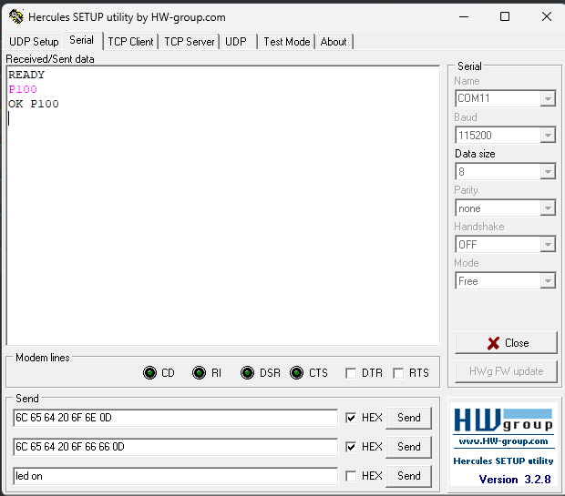
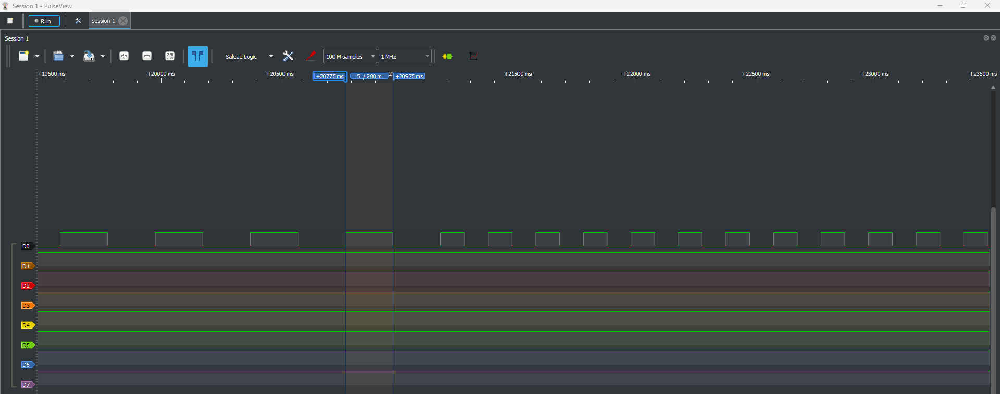
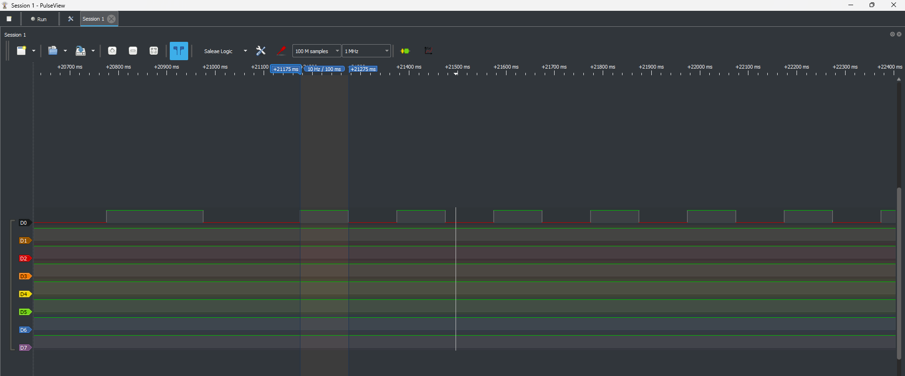
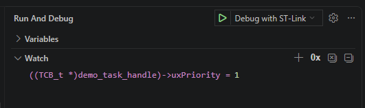
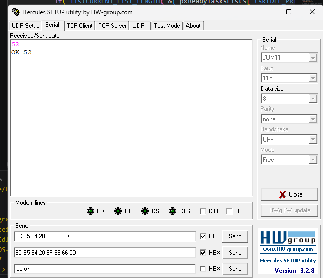
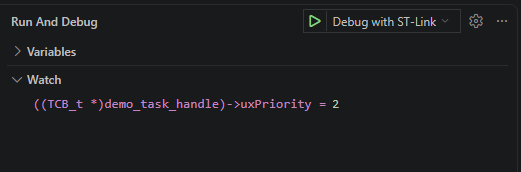
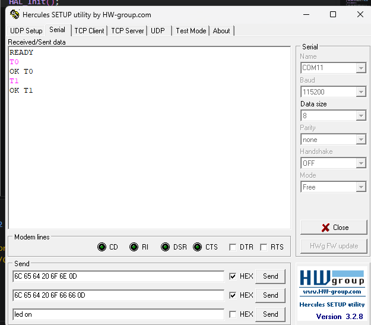
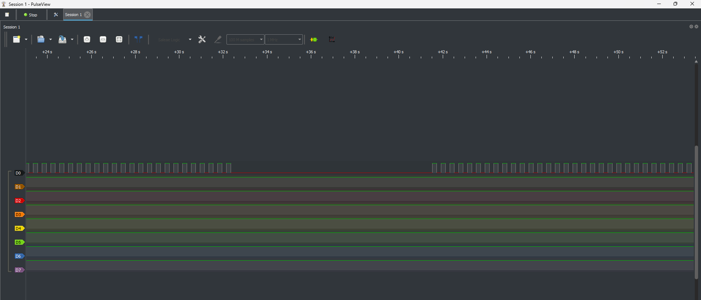

# Report — Week 3 / Ex3

`student_id`: 2412108    Commit của PREDICTION.md: `6a08308`

## 1. Thời gian byte & độ sâu stream buffer
Phép tính thời gian 1 byte ở `RX_BAUD`, và số lệnh tối đa chứa được trong
`STREAM_BUFFER_BYTES`.

- UART 115200 baud, 8N1: mỗi byte cần 10 bit, nên thời gian một byte là
  `10 / 115200 ≈ 86,8 µs`.
- Stream buffer 128 byte chứa được `floor(128 / L)` lệnh hoàn chỉnh nếu mỗi
  lệnh dài L byte, tính cả CR. Ví dụ `P10\r` dài 4 byte: chứa được 32 lệnh;
  lệnh có 31 byte nội dung và 1 CR: chứa được 4 lệnh.

## 2. Demo 3 loại lệnh
Bằng chứng (log/ảnh) `demo_task` phản ứng đúng với `P`, `S`, `T` — mỗi loại ít
nhất 1 ví dụ có số liệu trước/sau.

**P100 — khoảng toggle PA7 từ 200 ms xuống 100 ms:**

**S2 — priority của demo từ 1 lên 2:**

**T0/T1 — PA7 ngừng toggle rồi chạy lại:**

## 3. Test gửi nhanh
| | Số lệnh gửi | Số lệnh nhận đúng | Mất/lỗi |
|---|---|---|---|
| Gõ tay bình thường: P100, S2, T0, T1 | 4 | 4, có ACK | Không thấy lỗi trong 4 lệnh demo |
| Script, 128 byte, nghỉ 20 ms/lệnh | 100 | 100, có ACK | Không mất byte RX hoặc ACK |
| Script burst, 128 byte | 1000 | Parser đếm 1000 hợp lệ; xác nhận 545 qua ACK | RX drop = 0; mất 455 ACK do queue TX đầy |
| Script burst, 256 byte | 1000 | Parser đếm 1000 hợp lệ; xác nhận 549 qua ACK | RX drop = 0; mất 451 ACK do queue TX đầy |

Nếu có mất byte: giải thích bằng cơ chế (stream buffer đầy, parser bị trễ,
hay nguyên nhân khác) — không chỉ nói "bị mất".  
- Đối với trường hợp nhận và parse lệnh, không có hiện tượng mất dữ liệu trong cả 2 trường hợp gửi bằng tay và dùng script. Tuy nhiên khi dùng script thì ở chiều gửi đi, tx queue sẽ bị đầy và drop một số log nên là phản hồi sẽ bị nhảy số seq. Lí do là bởi vì phản hồi có nhiều byte hơn lệnh gửi. 

## 4. Vì sao stream buffer, không phải queue
Giải thích bằng lời của bạn.  
- Ta dùng stream buffer trong trường hợp cần dùng một luồng byte liên tục, còn với queue thì mặc dù ta được đặt kích thước của một item trong queue, mỗi lần đọc/ghi chỉ thao tác được với 1 item. Tuy nhiên thì ở bài này ta cũng chỉ ghi 1 byte mỗi lần vào trong stream buffer nên chưa thấy được sự khác biệt. Lấy ví dụ trường hợp parser vì một lí do gì đó mà bận trong 2ms, trong khoảng thời gian đó uart đã ghi vào stream buffer 20 byte, nếu dùng queue thì ta phải gọi api 20 lần mới lấy được hết dữ liệu mới, còn với stream buffer thì chỉ cần một api là lấy được hết ra.

## 5. Lệch so với dự đoán

| Dự đoán | Đối chiếu thực tế |
|---|---|
| Một byte mất 86,8 µs, parser xử lý kịp | Burst nhận đủ byte, parser đếm 1000 lệnh hợp lệ; chưa đo riêng thời gian xử lý mỗi byte. |
| Buffer 128 byte chứa 4 lệnh dài 32 byte | Đúng theo phép tính; chưa thử riêng khi parser ngừng đọc. |
| Parser bị trễ đủ lâu có thể làm đầy buffer RX | Chưa xảy ra ở tải đã thử: RX drop = 0 với cả buffer 128 và 256 byte. |
| Gõ tay không mất; burst có thể đầy queue TX | Khớp: 4 lệnh demo đều có ACK; burst mất 455 ACK với buffer 128 byte và 451 ACK với 256 byte, do queue TX đầy. |

## 6. Câu hỏi đánh đổi
Với `RX_BAUD` của bạn, nếu tăng gấp đôi `STREAM_BUFFER_BYTES`, tốc độ gửi tối
đa không mất byte tăng thêm bao nhiêu (đo thật, không suy luận)?  
- Với script burst ở trên, việc gửi gần như là liên tiếp (Khoảng trống do script/USB là giới hạn của nguồn phát nên ta không xét), có nghĩa là tốc độ gửi không thể tăng lên được nữa. Và trong test trên thì với buffer 128 bytes, không ghi nhận mất byte nên nếu có tăng gấp đôi thì cũng vậy.
