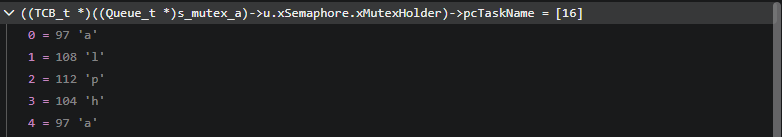
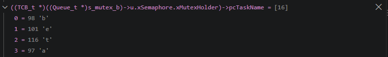
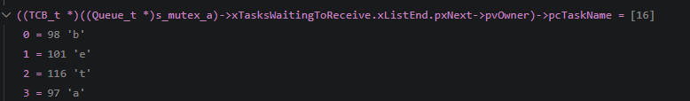
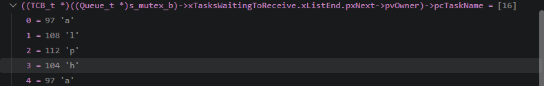
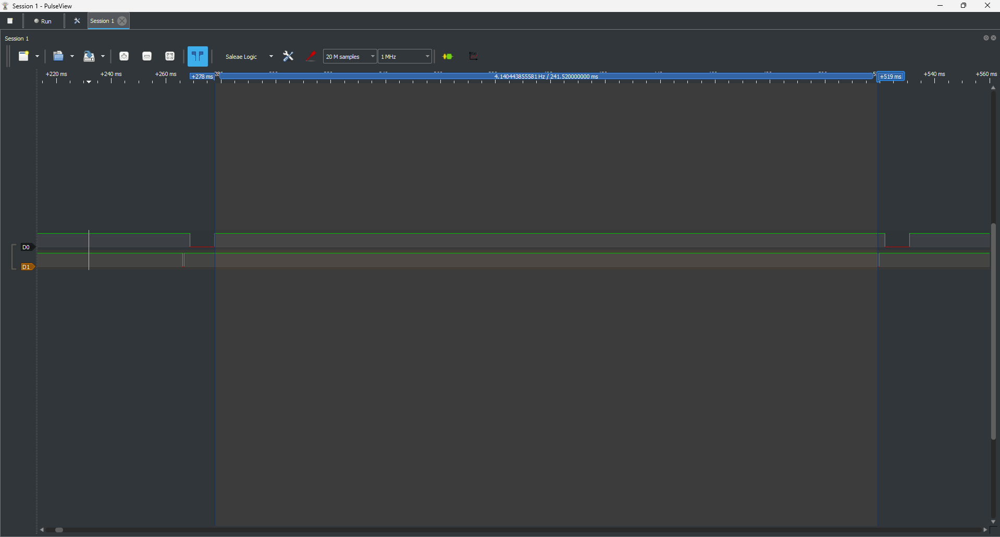
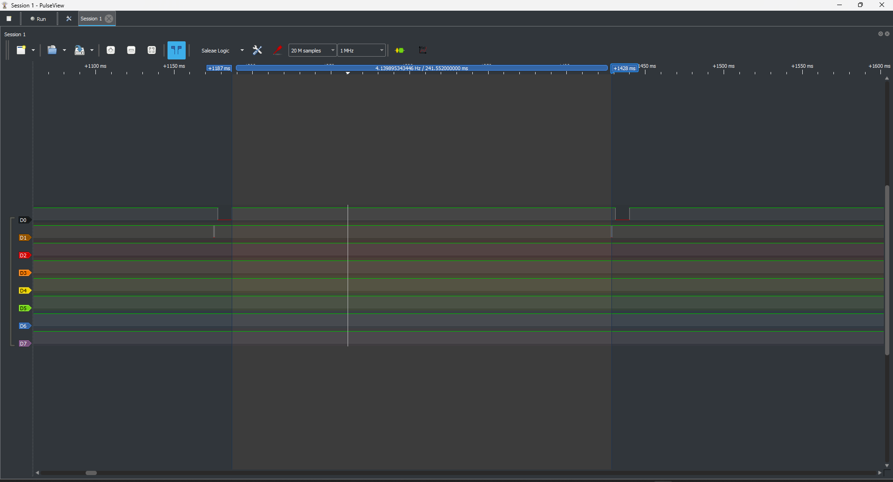

# Report — Week 3 / Ex4

`student_id`: 2412108    Commit của PREDICTION.md: `b1cd5bd`

Trạng thái: đã build/link phần thống kê runtime và snapshot trạng thái task;
giữ nguyên deadlock_demo.c để thu bằng chứng bản gốc. Chưa flash/debug trên board,
chưa có số đo phần cứng. Supervisor/IWDG và bước sửa deadlock chưa triển khai.

## 1. Bảng CPU %

| Task | CPU % (lần đo 1) | CPU % (lần đo 2) |
|---|---|---|
| alpha | <1% | <1% |
| beta | <1% | <1% |
| stats | <1% | 2% |
| supervisor | <1% | <1% |
| IDLE | 99% | 96% |

Giải thích Idle task chiếm bao nhiêu % và vì sao.  
- Trả lời: Idle ở lần 1 báo cáo 1 chiếm 99%, lần 2 96%. Có thể thấy hầu hết thời gian cpu đều ở trong Idle Task vì sau khoảng 5ms đầu, hệ thống bị deadlock, alpha và beta bị block vô hạn và chỉ còn lại stats là chạy được sau mỗi 1s (chỉ lấy số liệu và log uart rồi block 1s).

## 2. Bằng chứng tìm deadlock
Log/ảnh `uxTaskGetSystemState` **trước khi sửa**: trạng thái từng task, chỉ
rõ `task_alpha`/`task_beta` đang `eBlocked` và đang chờ mutex nào. Giải thích
chính xác thứ tự lấy mutex nào gây ra deadlock (AB-BA).

Log trước khi sửa: [uart_log.log](measurements/01_original_deadlock/uart_log.log).

Trích snapshot tại tick 1001:

```text
Task             | Cycles_low32 |  CPU%
stats            |         1196 |   <1%
IDLE             |     71991770 |   99%
beta             |         4171 |   <1%
alpha            |         3754 |   <1%

State snapshot
Task             | State      | Priority
stats            | Running    | 1
IDLE             | Ready      | 0
beta             | Blocked    | 2
alpha            | Blocked    | 2
```

Mutex A — task đang giữ: Alpha.



Mutex B — task đang giữ: Beta.



Mutex A — task đang chờ: Beta.



Mutex B — task đang chờ: Alpha.

  

- Từ log uart và 4 ảnh phía trên có thể thấy khi hệ thống deadlock, cả beta và alpha đều bị block, alpha thì đang chờ mutex_b được giữ bởi beta, còn beta thì chờ mutex_a được giữ bởi alpha.  
- Trình tự dẫn đến deadlock là: theo cấu hình hiện tại, beta chạy trước, lấy mutex_b, block 5ms. Sau đó đến alpha chạy, lấy mutex_a, block 5ms. Sau 5ms, beta thức dậy, lấy mutex_a nhưng không được do đang bị alpha giữ => block chờ cho đến khi alpha trả mutex_a. Trong khi đó khi alpha thức dậy, nó chờ ngược lại beta trả mutex_b => deadlock.

## 3. Sửa lỗi
Mô tả thay đổi bạn làm để hết deadlock (thứ tự lấy mutex thống nhất). Xác
nhận chạy ổn định sau khi sửa (thời gian chạy thử).  
- Trả lời: Sửa bằng cách thống nhất trình tự lấy mutex: cả alpha và beta đều lấy mutex_a trước rồi tới mutex_b. Flow là beta chạy, lấy mutex_a, block 5ms. Sau đó alpha chạy, lấy mutex_a nhưng không được, block chờ beta trả. Sau 5ms, beta thức dậy, lấy mutex_b rồi sau đó trả lại cả 2 mutex => alpha chạy lấy mutex_a, block 5ms, lấy mutex_b rồi trả lại cả 2.

Minh chứng sau khi sửa, **chưa bật supervisor/IWDG**:
[log UART test 2](measurements/02_fixed_no_watchdog/uart_log.log).
Log có 7 mẫu từ tick 1001 đến 7001, bao phủ 6 giây giữa hai mẫu đầu/cuối.

| Tick | Alpha cycles | Beta cycles |
|---:|---:|---:|
| 1001 | 233684 | 151281 |
| 7001 | 1635872 | 1048473 |

Cycles của cả Alpha và Beta tăng qua tất cả 7 mẫu, cho thấy hai task tiếp tục
được thực thi, khác bản deadlock có cycles giữ nguyên. Snapshot vẫn ghi Blocked
vì task có thể đang delay hoặc chờ mutex tạm thời tại lúc lấy mẫu; riêng trạng
thái Blocked không có nghĩa là deadlock. Không quan sát thấy hai task kẹt vĩnh
viễn như bản gốc trong khoảng log này.

## 4. Watchdog

Với LSI danh định 40 kHz, prescaler = 4, timeout = 250 ms:

```text
T = (Reload + 1) × Prescaler / f_LSI
Reload = 0,250 × 40000 / 4 − 1 = 2499
```

Để chỉ ra reset do deadlock, phải đổi stats từ chu kỳ 1000 ms sang check-in
mỗi **50 ms**, vẫn in mỗi 1000 ms; nếu không, riêng stats đã chậm hơn timeout
watchdog. Supervisor chờ đủ 3 bit trong **150 ms**. Trước hết chạy bản không
deadlock để xác nhận không reset, sau đó giữ nguyên cấu hình này và chỉ đổi
Beta sang lấy B → A để tái tạo deadlock.

- [Log test 3 — không deadlock](measurements/03_watchdog_healthy/uart_log.log):
  không reset trong khoảng 18 giây quan sát; timeout = 0, max refresh gap = 108 ms.
- [Log test 4 — tái tạo deadlock](measurements/04_watchdog_deadlock/uart_log.log):
  105 lần `BOOT test4 reset=IWDG`, xác nhận reset do watchdog.

Đo D0 = PA7, D1 = NRST ở 1 MHz: từ **PA7 lên HIGH → NRST xuống LOW** là
**241,520 ms**. PA7 là mốc xấp xỉ bắt đầu deadlock. Khoảng này không bằng đúng
250 ms vì IWDG đã chạy trước mốc PA7 và LSI có sai số.



## 5. Lệch so với dự đoán

| Mục dự đoán | Kết quả thực tế và nhận xét |
|---|---|
| Deadlock sau khoảng 5 ms | Đã xác nhận deadlock, nhưng chưa đo riêng thời điểm bắt đầu nên chưa kết luận độ lệch so với 5 ms. |
| Alpha/Beta đều Blocked; Alpha chờ mutex B, Beta chờ mutex A | Đúng dự đoán, được xác nhận bằng log và 4 ảnh debugger ở mục 2. |
| Reload IWDG = 2499 | Cấu hình thực tế dùng 2499, đúng phép tính với LSI danh định 40 kHz; chưa đo riêng tần số LSI. |
| Board reset sau khoảng 250 ms khi tái tạo deadlock | Board reset do IWDG, đúng dự đoán về hành vi. Đo từ mốc xấp xỉ deadlock đến reset được 241,520 ms. IWDG đã chạy trước mốc này và LSI có sai số, nên không coi chênh lệch 8,480 ms là sai số timeout watchdog. |

## 6. Câu hỏi đánh đổi
Với `SUPERVISOR_BITS` và chu kỳ check-in của bạn, nếu một task thật sự chạy
chậm (không deadlock, chỉ chậm) trong đúng 1 chu kỳ, supervisor có false-trip
(reset oan) không? Trả lời bằng số đo thời gian thực tế của chu kỳ check-in.

- Trả lời: Có, nếu task chậm đến mức watchdog hết hạn trước khi nhận đủ
  check-in. Watchdog chỉ biết task không báo tiến triển đúng hạn, không phân
  biệt task đang deadlock hay chỉ xử lý lâu. 

- Test 5 giữ cả Alpha/Beta lấy A → B để không tạo deadlock. Ngay vòng đầu,
  Alpha đã nhả cả hai mutex rồi cố ý delay **350 ms** trước lần check-in đầu
  tiên. Do chưa có bit Alpha, supervisor không đủ 3 bit để refresh IWDG.
  [Log test 5](measurements/05_slow_checkin/uart_log.log) có **61 lần reset do IWDG**.
  Đo từ PA7 lên HIGH (bắt đầu chậm) đến NRST xuống LOW được **241,552 ms**,
  nên board reset trước khi Alpha hoàn tất khoảng chờ 350 ms.


